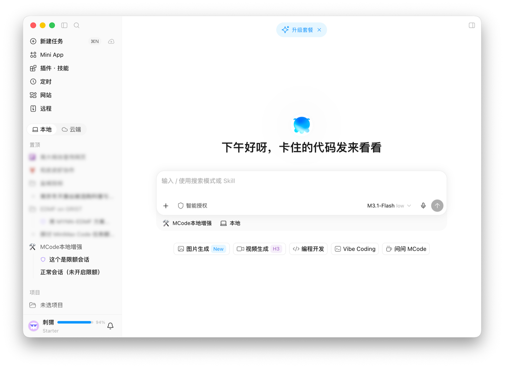
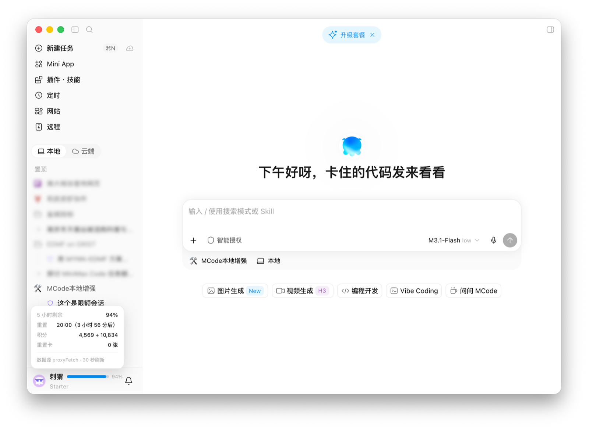
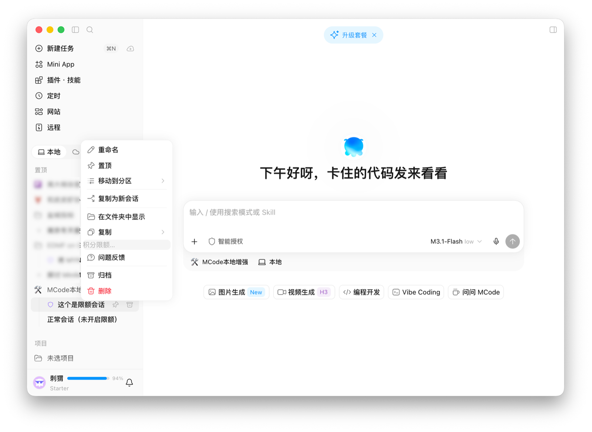
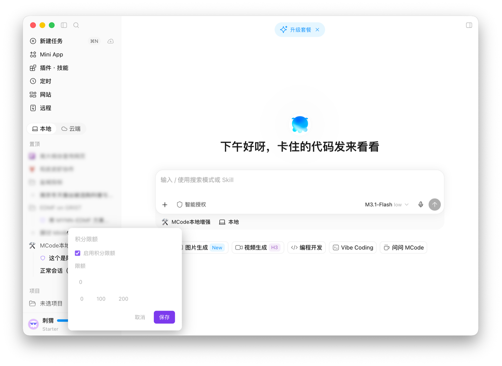

# MiniMax Code 本地增强

给 MiniMax Code 加上两个小工具：**1：随时看额度，2：为会话设积分限额。**

长任务跑起来以后，既想知道这一轮额度还剩多少，也想给积分消耗留个边界。这个项目把用量条和会话积分守护放在一起维护，两者可以单独使用，后台运行、登录自启动和自动重启都由你选择。

**当前版本：0.2.0 · 开发预览版。** 仅支持 macOS，需要 Node.js 24+，不需要安装 npm 依赖。适合愿意通过命令行安装、排查问题，或想参考实现的开发者。Windows 暂不支持（有需要可自行参考）。



侧边栏底部常驻额度条；插件分组下，带盾形标记的会话已开启积分限额。

## 额度不用翻来翻去找

用量条（quotabar）放在 MiniMax Code 侧边栏底部，显示当前 5 小时额度进度。鼠标悬停后，可以看到剩余额度、重置时间、付费与赠予积分，以及可用重置卡数量。



悬停展开的读数直接取自账号当前状态，页面内每 30 秒刷新一次。

它适合留在视线里：准备开一个长任务前看一眼，跑到一半再看一眼，不用每次去找账户页面。

可以只注入一次，也可以允许后台守护在页面重载后补回用量条。单次模式仍会在页面内刷新数据，但不启动独立后台进程。

## 给会话留一道消费边界

有的任务不希望耗费或耗费太多积分（包含充值赠的和签到等活动攒的），慢慢用5小时额度做就行，这里就提供了这个功能：该停自动停，等到点了再自动启动。

会话积分限额（credit-guard）在会话右键菜单里提供设置入口。可以为需要的会话打开限额，选一个预设值或填写自己的数值；达到限额后，守护会请求停止会话，并确认关联的后台活动是否停下。

**开始之前，先确认 MiniMax Code 设置里的「使用积分」已经打开。** 它的说明是「开启后，可以在对话中消耗你的积分（含赠予积分）。」关闭时对话不消耗积分，账户余额不会下降，限额也就永远不会被触发。侧边栏额度条显示的是账户积分概览（付费 + 赠予），与这个开关无关。



在任意会话上点右键，菜单里就会多出「积分限额…」这一项。



限额只对当前这一个会话生效。可以直接用 0 / 100 / 200 的预设，也可以自己填一个数。

如果会话确实由积分守护暂停，而且你没有手动接管或改动它，下一计量周期到来时，守护会在满足条件后尝试恢复。你手动停止、发消息或改动会话后，它不会继续按原来的暂停记录自动续跑。

**这里的“会话限额”是保守估算，不是逐会话账单，也不是精确扣费上限。** 守护观察的是账号总积分余额：每次余额下降，会把下降值完整计入所有已开启限额的会话。因此，其他会话或设备上的消费也可能让受管会话提前停止；采样和结算延迟也可能带来超额。

计量周期按北京时间每天 **00、05、10、15、20 点**重置，最后一段为 20 点到次日 00 点。限额设为 0，表示首次观察到积分下降时触发停止。积分守护需要后台持续采样，使用前须明确允许后台运行。

## 运行到什么程度，你来选

两个模块默认都关闭，安装后不会自行开始工作。

| 选择 | 会发生什么 |
|---|---|
| 启用模块 | 开始使用所选功能，两个模块互不捆绑 |
| 允许后台常驻 | 允许独立守护持续采样或维护页面注入 |
| 允许登录自启动 | 登录后启动已启用模块的守护，需要先允许后台运行 |
| 允许自动重启 | 仅供用量条使用，修复失败且确认全局空闲后，才尝试正常退出并重开客户端 |

`stop` 会保存停用状态；`repair` 只修复已经启用的模块，不会替你开启权限或重启客户端。

自动重启还会检查完整、及时的会话活动信息，退出前再次确认。无法确认、缺少调试连接或接口发生变化时就延后；不会强杀客户端。详细条件见 [安装说明](docs/installation.md)。

## 从这里开始

先确认环境：macOS、Node.js 24+。模块通过本机 CDP 连接客户端，默认端口为 **9333**，客户端需要带 `--remote-debugging-port=9333` 启动。安装器不会替你退出或重启客户端，也不会修改系统代理。

在项目根目录查看命令与安装预览：

```bash
npm run manage -- help
npm run manage -- install --data-dir /path/to/profile
```

`/path/to/profile` 是 MiniMax Code 的配置目录；省略 `--data-dir` 时，使用 `MINIMAX_DATA_DIR` 或当前用户的 `.minimax` 目录。首次安装需要提供一张有权使用的图标，深色图标可选。安装、迁移和回退默认只预览，加 `--apply` 才执行；执行时客户端必须关闭，相关守护作业也须已撤销登记。

如果已经装过独立的 quotabar 或 credit-guard，用迁移预览代替普通安装：

```bash
npm run manage -- migrate --data-dir /path/to/profile
```

迁移保留当时已有的会话限额和累计状态，新的后台权限仍从关闭开始。**正式操作前，请按 [安装与迁移指南](docs/installation.md) 完成离线准备，并查看预览列出的阻塞项。**

统一插件安装完成后，例如只想常驻用量条：

```bash
npm run manage -- configure quotabar --background on
npm run manage -- start quotabar
```

积分守护单独开启：

```bash
npm run manage -- configure credit-guard --background on
npm run manage -- start credit-guard
```

不需要时，单独停用；查询状态不会启动或修复模块：

```bash
npm run manage -- stop quotabar
npm run status
```

这些命令默认操作默认配置目录；如果安装在其他目录，控制命令也要带相同的 `--data-dir`。

统一包也提供 MCP 工具，供 Agent 查询状态、配置权限、启停和修复。可以用自然语言表达意图，例如“查看本地增强状态”“只启用用量条”；涉及后台、自启动或自动重启时，要明确告诉 Agent 你的选择。工具名与参数见 [安装说明](docs/installation.md)。

## 使用前需要知道的事

- **这是非官方本地增强项目。** 依赖 MiniMax Code 的页面结构和内部接口，客户端升级后可能需要适配。旧模块有 MiniMax Code 3.1.16 的本机使用记录，这不代表统一包已完成该版本或后续版本的全部集成检查。
- **统一入口已通过隔离测试，真实部署仍需验证。** 当前 50 项自动化测试通过；真实客户端插件识别、launchd、登录自启动、实际重启，以及真实迁移和回退尚未完成整体验证。
- **限额是辅助控制。** 页面或调试连接完全不可达时，不能保证停止成功。重要任务请结合状态和实际消费判断，不要把它当成账户级硬性扣费限制。
- **调试连接只供本机使用。** CDP 具备页面执行权限，不要将端口暴露到网络；运行状态也可能包含账号读数和会话标识，不要上传到公开仓库。

## 想看实现或继续开发

| 内容 | 入口 |
|---|---|
| 安装、权限选择、迁移与回退 | [安装指南](docs/installation.md) |
| 用量条的机制和旧版行为 | [quotabar](docs/quotabar.md) |
| 积分计量、停止与恢复规则 | [credit-guard](docs/credit-guard.md) |
| 维护和排障 | [维护说明](docs/maintenance.md) |
| 尚未验证的发行事项 | [发行检查](docs/release.md) |
| 源码来源及版本变化 | [源码说明](docs/source-notes.md) |
| Agent 协作约定 | [AGENTS.md](AGENTS.md) |

`modules/` 放两个模块，`runtime/` 放统一控制和 MCP，`scripts/` 放安装与命令行入口，`tests/` 放模拟和隔离测试。旧模块的 Hook、MCP 和 shell 脚本保留用于参考，使用时以统一入口为准；它们不进入统一安装包。

```bash
npm run check
npm test
```

测试会在仓库外相邻的 `local/work/` 创建模拟配置，不连接生产 CDP 或操作真实守护。`npm run status:legacy` 可查看旧版部署的只读摘要。

## 许可证

本项目源码采用 [0BSD（BSD Zero Clause）](LICENSE)：可以使用、修改、再分发和商用，不要求公开修改后的源码，也不要求保留署名或许可文本。软件按原样提供，不作担保。

此许可不授予 MiniMax Code 的商标、客户端代码或其他第三方素材的使用权；客户端图标与应用提取物不随本仓库分发。
