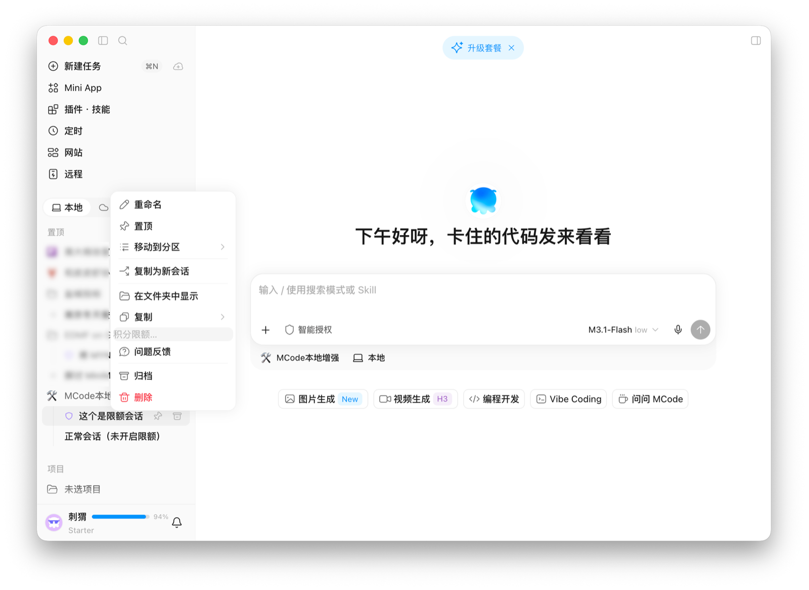
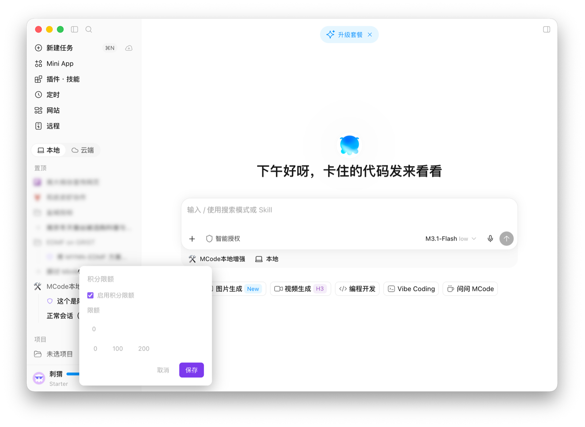

# credit-guard：会话积分限额

规则基于生产插件 1.0.2，生产仍保留两套原插件。维护副本位于 `modules/credit-guard/`；统一入口 0.2.0 的安装方法见 [installation.md](installation.md)，本轮未切换生产。

## 统一入口 0.2.0

模块默认停用，须先主动授予 background 再 start；autostart 另行选择，积分模块不支持 autoRestart。统一包不含旧 Hook 或旧控制器。repair 不授予权限或启用停用模块；stop 保存停用状态并优雅退出，保留原来取消预算自动恢复资格的安全收尾。迁移保留旧状态字节、消费累计和暂停指纹，不静默继承后台授权，损坏状态拒绝迁移。

下面的计量与停止恢复规则继续适用；涉及旧 MCP、旧标签和 Hook 的描述用于说明当前生产，统一包操作以安装说明为准。

## 计量与停止恢复

前置条件：MiniMax Code 设置里的「使用积分」需保持开启，其说明为「开启后，可以在对话中消耗你的积分（含赠予积分）」。守护靠余额下降来计量消耗；该选项关闭时对话不消耗积分，余额不下降，限额不会触发。侧边栏额度条读的是账户积分概览，不受这个开关影响。

逐会话开启限额，可选 0、100、200 或自定非负值。周期固定为北京时间 00、05、10、15、20 点，20 点到次日 00 点只有四小时。约每 15 秒采样账号总余额，把每次下降全额计入所有已开启会话；这是保守近似，不是会话独立账单，其他会话或设备消费也可能触发停止。0 表示首次观察到余额下降时触发，不是开启即停；采样、结算延迟可能造成超额。

达到限额后走完整 `user_stop`，再用递归 `getSessionActivity` 确认主会话、Goal 和后台子任务停止；递归有 64 会话、100 任务页上限，截断时不能确认全停，不得报告成功。仅由预算守护拥有暂停权、fingerprint（会话/末消息/Goal 标识及更新时间）未变、读数新鲜且状态可续跑时，才在下一周期自动恢复。手动停止、发消息或修改状态会取消恢复资格；等待用户确认时不自动接管。

## 生效、后台与失效

仅支持 macOS，依赖 Node、页面内部接口及本机 CDP 9333；不会自行重启应用或修改系统代理。`credit_guard_enable/repair` 写启用标记并请求 launchd 作业 `com.minimax.credit-guard.daemon` 启动，不保证注入完成；SessionStart Hook 只自动拉起已启用守护。`status` 查询标记、进程、健康与适配器状态。

读数持续失效超过 60 秒会保守停止受管活动会话；守护心跳断开超过 90 秒，仍存活的页面 watchdog 尝试停止并取消自动恢复。页面或 CDP 整体不可达时不能保证停止成功，应查错误并人工确认。`disable` 写停用标记，等待当前操作安全完成、取消自动恢复、清理页面后退出，不强杀、不自动续跑。

## 数据与卸载

状态在 `<dataDir>/credit-guard/`，含余额基线、会话标识、暂停指纹及账户摘要哈希，文件按私有权限写入；适配器读取会话、Goal、末消息和活动信息并包装控制接口。CDP 具有页面执行权限，应仅供本机使用。原安装源码含机器绑定的默认状态路径；仓库维护副本已改为当前用户 HOME 下的默认目录，保留 `CREDIT_GUARD_STATE_DIR`。此改动未回写生产插件，部署时仍须核对实际状态位置。

完整卸载无需先关应用：先调用停用并确认安全退出，再禁用插件及 Hook、撤销残留 launchd 登记；确认适配器已清理后，将插件和状态目录移入废纸篓。清理失败时在任务安全后重载页面；调试参数若无其他模块需要，再从启动入口撤下。

MiniMax Code 3.1.16 已有普通/Goal 真实停止恢复、后台子任务真实停止记录。本次重新运行了迁入仓库的 16 项纯模拟规则测试，全部通过；跨周期使用模拟时间，未实际跨越时钟边界，也未重跑真实会话。0.2.0 已提供后台与自启动的独立主动选择；真实新用户安装、客户端识别和系统服务集成仍未检查，不能用模拟结果代替。
