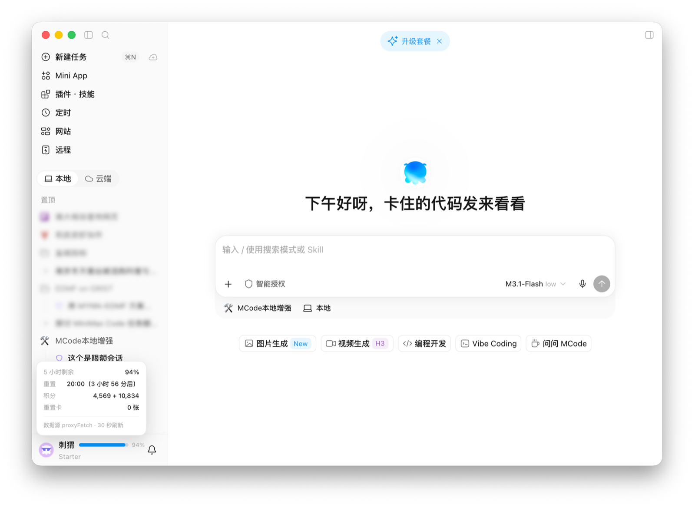

# quotabar：侧边栏限额条

下述旧行为依据生产插件 1.1.0，生产尚未切换。维护副本位于 `modules/quotabar/`，统一入口为 0.2.0，安装说明见 [installation.md](installation.md)。源码采用仓库根目录的 0BSD 许可；真实客户端安装仍需另行验证。

## 统一入口 0.2.0

统一包不含旧 Hook、巡检或 shell 重启脚本。模块默认关闭；background、autostart、autoRestart 分别主动选择。stop 保存停用状态并停止统一标签的守护，repair 不开启停用模块也不重启客户端。无后台授权可单次注入，页面本身仍有刷新定时器；后台授权才允许独立 supervisor 约每 30 秒补注入。只匹配 app:// 页面，不回退其他网页。具体重启条件、离线迁移和回退语义见安装说明。

以下章节记录仍在生产使用的旧插件行为，不能用来操作统一包。

## 生效与后台行为

在 macOS MiniMax Code 侧边栏显示 5 小时额度、重置时间、积分与重置卡。通过本地 CDP 调试端口（默认 9333）注入页面；桌面端须带 `--remote-debugging-port=9333` 启动，插件加载本身不能补出端口。Node 注入器由独立 launchd 作业 `com.minimax.quotabar.daemon` 承载，约每 30 秒重读脚本。

SessionStart Hook 在端口可用时自动拉守护、补注入，本身不重启应用。另有可安装的 60 秒巡检 LaunchAgent `com.minimax.quotabar`：缺端口且按文件修改时间判断空闲时，会提交 `com.minimax.quotabar.restart-once` 重启应用；最近 3 分钟会话或后台任务文件有活动则延后。该判据不是可靠的任务完成确认；一次性脚本有 30 秒缓冲、20 分钟冷却，退出超时还会强制结束旧进程，存在中断风险。

## 启停与排障

`quotabar_status/read` 查询状态和读数；`repair` 拉守护并重注入，不重启应用；`enable` 安装或更新独立守护，巡检另由 `src/install-autostart.sh` 安装。`disable` 仅停独立守护，Hook 或巡检可能再次拉起，不能当作完整停用。

失效时先查端口、守护、注入和读数更新时间；端口正常而页面失效，应检查应用升级后的接口与 DOM，旧读数不能当作实时值。需要重启时先确认任务安全，不能仅凭自动空闲判断保证无损。

## 数据、权限与卸载

沿用应用登录态读取官方额度、积分和重置卡接口；日志、状态和运行入口软链在 `<dataDir>/quotabar/`。巡检检查会话与后台任务文件的修改时间。CDP 能执行页面代码，应限制在本机，不暴露到网络；维护日志也可能含账户数据或本机路径。

完整卸载无需先关闭应用：先禁用插件及 SessionStart Hook，卸载巡检 LaunchAgent 并移入废纸篓，再撤销待执行的一次性重启作业、停止独立守护；确认不会再拉起后，将插件目录及运行目录移入废纸篓。残留页面注入可在方便时重载清除；下一次正常启动不再携带调试参数，另行核对其他启动入口。

旧生产插件已有 MiniMax Code 3.1.16 本机检查记录，不能据此推断统一包的新用户安装或后续版本兼容。0.2.0 已提供独立权限选择；旧生产代码仍保持历史行为，未因仓库改动自动变成默认关闭。
